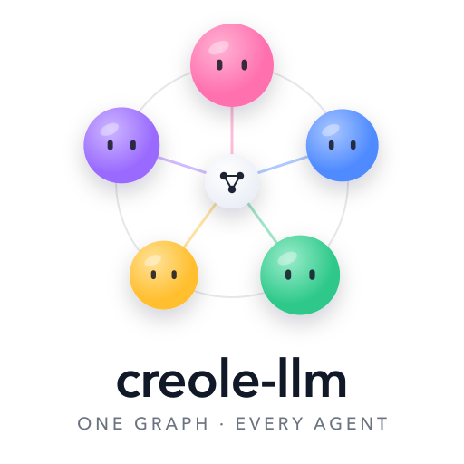
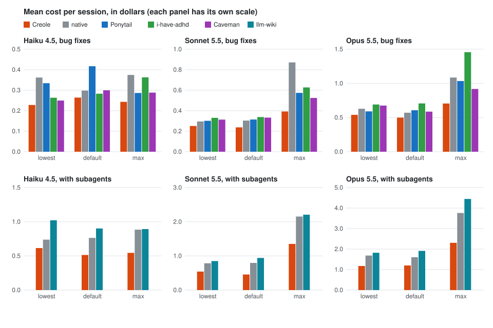

<p align="center">
  <picture>
    <source media="(prefers-color-scheme: dark)" srcset="assets/logo-dark.png">
    
  </picture>
</p>

<p align="center">
  <em>Fewer tokens. Same work. The agent keeps what matters when the context fills up.</em>
</p>

<p align="center">
  <a href="https://github.com/gluppler/Creole-LLM/actions/workflows/test.yml"></a>
  
  <a href="LICENSE"></a>
</p>

<p align="center">
  <strong>20% to 45% lower cost than plain Claude Code</strong><br>
  <sub>Mean over three scripted tasks, at lowest, default and max effort on Haiku 4.5, Sonnet 5.5 and Opus 5.5. One session per task and setting; all 27 Creole sessions passed their task. Claude Code 2.1.309. <a href="#numbers">Details</a>.</sub>
</p>

---

## Install

Claude Code:

```sh
claude plugin marketplace add gluppler/Creole-LLM
claude plugin install creole@creole-llm
```

Other agents:

| Agent | Install |
|---|---|
| GitHub Copilot CLI | `copilot plugin marketplace add gluppler/Creole-LLM`, then `copilot plugin install creole@creole-llm` |
| Devin CLI | `devin plugins install gluppler/Creole-LLM` |
| Grok Build | `grok plugin install gluppler/Creole-LLM --trust` |
| OpenCode | add `"creole-llm"` to `plugin` in `opencode.json` |
| npm (any tool that installs packages) | `npm install creole-llm` |
| Codex, Cursor, Qoder, omp, pi | install from a clone: [INSTALL.md](INSTALL.md) |
| Any agent with skills | `npx skills add gluppler/Creole-LLM` |
| Any agent that reads `AGENTS.md` or a rules folder | copy [`AGENTS.md`](AGENTS.md), or the rules file for your agent |

Update (Claude Code): `claude plugin marketplace update creole-llm`, then
`claude plugin update creole@creole-llm`, and restart.

Every agent, updating, uninstalling and the data Creole leaves behind: [INSTALL.md](INSTALL.md).

## What it does

creole-llm is a plugin that makes a coding agent cheaper on long sessions without
forgetting the task, by teaching it Creole, a compact working language. No training,
no GPU, no second model.

1. **A compact working language.** The agent thinks, plans and replies in plain English
   words in the shape of code: one fact per line, no filler, every number and error kept.
2. **Compaction that keeps the task.** When the context fills, the conversation becomes
   a session graph of about 250 words (task, the user's constraints word for word, what
   is built, decisions, open issues, the last step) plus the user's own messages.
3. **One record for every agent.** Subagents start from the session graph and merge
   what they learn back into it, so the main agent and its subagents share one wiki.
4. **Works beside other plugins.** Another plugin's rules win for what they prescribe,
   and after each compaction the agent is told to reload the skills it had invoked.
5. **Runs on 20+ agents.** Compaction on Claude Code, Codex, Cursor, Qoder, omp and pi;
   the rules every turn on OpenCode and at session start on Copilot CLI; and the rules
   file on every agent that reads `AGENTS.md` or a rules folder.

## Before / after

<table>
<tr>
<td width="50%" valign="top">

**Before**

> 6 tests are still failing:
>
> - `test_blend_bucket_700` (util8): expects 31, got 32
> - `test_clamp_bucket_723` (util8): expects 20, got 21
> - ... four more ...
>
> All 6 failures are in util8.py, which you explicitly withdrew from the task.
> These are not to be fixed per your constraint.

</td>
<td width="50%" valign="top">

**After**

> Done: issues 1-24 fixed; the 6 you withdrew still fail, as asked.<br>
> checked: full suite -> 24 pass, 6 fail

</td>
</tr>
</table>

## The rules

Full text in [SKILL.md](skills/creole/SKILL.md).

1. One fact, step or action per line; drop filler, keep every meaning-bearing word.
2. Read the code a change touches first; take the first option that fully works.
3. The shortest working diff wins; never cut validation, safety or accessibility.
4. A user's constraint on a file beats a listed task, for the whole session.
5. Find every target with one search; run the checks once, after the last edit.
6. Reply with the outcome, what was checked, and any next action. Nothing else.
7. Another skill or plugin in force wins for what it prescribes.

## Numbers

Cost per session as Claude Code reports it, which may differ from what a subscription
bills. Each plugin runs in its own sandbox with a pinned copy. One session per task and
setting on Claude Code 2.1.309. Lowest is thinking off on Haiku and `--effort low`
elsewhere; default sets no flag; max is `--effort max`.

<p align="center"></p>

Bug fixes, the mean of a short fix and a 30-issue review (lowest in bold):

| Model | Effort | Creole | native | Ponytail | i-have-adhd | Caveman |
|---|---|---|---|---|---|---|
| Haiku 4.5 | lowest | **$0.228** | $0.362 | $0.334 | $0.263 | $0.250 |
| Haiku 4.5 | default | **$0.264** | $0.298 | $0.417 | $0.283 | $0.299 |
| Haiku 4.5 | max | **$0.243** | $0.374 | $0.286 | $0.363 | $0.288 |
| Sonnet 5.5 | lowest | **$0.251** | $0.295 | $0.301 | $0.330 | $0.313 |
| Sonnet 5.5 | default | **$0.237** | $0.303 | $0.314 | $0.338 | $0.333 |
| Sonnet 5.5 | max | **$0.392** | $0.871 | $0.574 | $0.627 | $0.524 |
| Opus 5.5 | lowest | **$0.539** | $0.628 | $0.590 | $0.690 | $0.675 |
| Opus 5.5 | default | **$0.498** | $0.571 | $0.607 | $0.706 | $0.586 |
| Opus 5.5 | max | **$0.705** | $1.085 | $1.034 | $1.457 | $0.918 |

A review with two subagents:

| Model | Effort | Creole | native | llm-wiki |
|---|---|---|---|---|
| Haiku 4.5 | lowest | **$0.615** | $0.738 | $1.021 |
| Haiku 4.5 | default | **$0.513** | $0.764 | $0.902 |
| Haiku 4.5 | max | **$0.544** | $0.884 | $0.892 |
| Sonnet 5.5 | lowest | **$0.541** | $0.785 | $0.849 |
| Sonnet 5.5 | default | **$0.456** | $0.795 | $0.940 |
| Sonnet 5.5 | max | **$1.352** | $2.152 | $2.207 |
| Opus 5.5 | lowest | **$1.174** | $1.685 | $1.821 |
| Opus 5.5 | default | **$1.200** | $1.602 | $1.913 |
| Opus 5.5 | max | **$2.306** | $3.759 | $4.444 |

Ponytail's own tasks (four small coding jobs from its benchmark, with hidden checks for
correctness and safety): tasks passed, Python source lines changed per task with tests
aside (Ponytail's own measure), and cost.

| Model | Effort | Creole passed | native passed | Ponytail passed | Creole lines | native lines | Ponytail lines | Creole cost | native cost | Ponytail cost |
|---|---|---|---|---|---|---|---|---|---|---|
| Haiku 4.5 | lowest | 4/4 | 4/4 | 4/4 | 95.0 | 73.0 | 42.3 | $0.037 | $0.035 | $0.038 |
| Haiku 4.5 | default | 4/4 | 4/4 | 3/4 | 53.3 | 44.3 | 9.8 | $0.042 | $0.033 | $0.036 |
| Haiku 4.5 | max | 4/4 | 4/4 | 4/4 | 67.0 | 57.5 | 30.0 | $0.039 | $0.040 | $0.041 |
| Sonnet 5.5 | lowest | 4/4 | 4/4 | 4/4 | 48.3 | 59.0 | 24.3 | $0.050 | $0.045 | $0.049 |
| Sonnet 5.5 | default | 4/4 | 4/4 | 4/4 | 55.3 | 74.5 | 35.8 | $0.056 | $0.065 | $0.056 |
| Sonnet 5.5 | max | 4/4 | 4/4 | 4/4 | 66.8 | 200.5 | 32.8 | $0.346 | $0.588 | $0.303 |
| Opus 5.5 | lowest | 4/4 | 4/4 | 4/4 | 51.5 | 71.5 | 32.3 | $0.122 | $0.114 | $0.107 |
| Opus 5.5 | default | 4/4 | 4/4 | 4/4 | 64.8 | 92.5 | 48.0 | $0.153 | $0.156 | $0.127 |
| Opus 5.5 | max | 4/4 | 4/4 | 4/4 | 77.0 | 196.0 | 36.0 | $0.854 | $2.138 | $0.750 |

Against each plugin at its own thing, across the nine settings (Creole better / tied /
plugin better):

| Plugin | Its own thing, as measured | Result | Cost |
|---|---|---|---|
| Ponytail | source lines changed, on Ponytail's own tasks | 0 / 0 / 9 | 2 / 0 / 7 |
| Ponytail | lines per fix, on the bug fixes | 0 / 9 / 0 | 9 / 0 / 0 |
| i-have-adhd | words in the final reply | 7 / 0 / 2 | 9 / 0 / 0 |
| Caveman | output tokens | 5 / 0 / 4 | 9 / 0 / 0 |
| llm-wiki | subagent session passing its task and hard rules | 1 / 8 / 0 | 9 / 0 / 0 |

- Cheaper than plain Claude Code at all nine settings over the three tasks, but not on
  every task: the short fix cost more at six of them.
- All 27 Creole sessions passed their task and broke no hard rule. Ponytail failed one of
  its own tasks (Haiku 4.5, default: no file written, which also lowers its line count there).
- Ponytail writes less code on its own tasks at every setting, often half of Creole's,
  and costs less there at seven settings. Creole does not beat it at that.
- Caveman's output tokens and Creole's are within 12% of each other at every setting.
- Replies to the review's last question, checked against the session: Creole and
  i-have-adhd each gave the right failing-test count in the first line and named the cause
  in 9 of 9, and showed the tests run in 6 of 9; Creole's replies averaged 45 words,
  i-have-adhd's 81.
- Creole's bug-fix and subagent sessions are from a later run than the other arms (same
  tasks, sandboxes and Claude Code version). One session per cell, so these are observations, not verdicts;
  single sessions vary by about a quarter, which is more than some of these gaps.
- Not tested: Fable 5.1, which needs usage credits. Not shown: lower cost on every kind
  of task, public benchmark scores, or five hours of maximum-effort work.

## Support

| Agent | Route | Tier |
|---|---|---|
| Claude Code 2.1.309 | function hooks (`hooks/creole-module.mjs`) | live-verified |
| Codex 0.162.1 | command hooks | mock-tested |
| omp, pi | extension (`extensions/creole.ts`) | mock-tested; no session wiki |
| Windsurf, Cline, Kiro | their rules folders | instruction |
| GitHub Copilot | `.github/copilot-instructions.md` | instruction |
| Gemini CLI, Qwen Code, Kimi Code | `AGENTS.md` as context, `.kimi-plugin/` | instruction |
| OpenCode | server plugin (`.opencode/plugins/creole.mjs`) | mock-tested |
| Cursor, Qoder | plugins with Creole's hooks (or a rules file) | mock-tested |
| GitHub Copilot CLI | plugin, rules at session start | mock-tested |
| Devin CLI, Grok Build | their plugin installers | instruction |
| Amp, Zed, Jules, Goose, Junie and any agent that reads `AGENTS.md` | `AGENTS.md` | instruction |

Tiers are defined in [INSTALL.md](INSTALL.md).

## Settings

| Setting | Default / behavior |
|---|---|
| `CREOLE_HEADROOM_TOKENS` | 100000; compact once the context has grown this far past its smallest size (below 100k, the window's share binds) |
| `CREOLE_THRESHOLD_PERCENT` | 60; never let the context pass this share of the window first |
| `CREOLE_CONTEXT_WINDOW_TOKENS` | For routes without a host-reported window |
| `CREOLE_MAX_WORDS` | 250; the graph's target, soft after one correction |
| `CREOLE_LANGUAGE` | On; `off` removes the language and its work and reply rules |
| `CREOLE_WIKI` | On; `off` stops the session wiki and the codebase map, and deletes nothing |
| `CREOLE_AUTO_COMPACT=0` | Stops the compactions the omp extension starts |
| `CREOLE_CHECKPOINT` | `graph`; `natural` and `proposal` exist for comparison experiments only |

Nothing to configure: the defaults adapt on their own (an unset headroom grows when
compactions come close together and shrinks back). To override one, set its `CREOLE_*`
environment variable. Claude Code's own auto-compaction settings win
over Creole's. Each compaction says what it did, or why Creole could not and the host
compacted instead; `--debug-file <path>` logs every turn, compaction and subagent merge.

**Privacy.** Session records (the user's messages with known credential patterns
removed, and the last graph) stay on your machine, capped at 256 KiB per session and
3 MiB in all, and are removed once a session has gone 30 days without use. Redaction is pattern-based.
Where they live and how to delete them: [INSTALL.md](INSTALL.md#data-left-behind).

**Access.** No dependencies, no install scripts, no network. Creole reads the host's
plugin folder and data folder variables (`CLAUDE_PLUGIN_ROOT`, `CLAUDE_PLUGIN_DATA`,
`PLUGIN_ROOT`, `PLUGIN_DATA`, `COPILOT_PLUGIN_DATA`, `CURSOR_VERSION`, Claude Code's
`CLAUDE_PLUGIN_OPTION_*` settings) and its own `CREOLE_*` settings, and no other
environment variable. It reads the host's session log for token use, its skill file,
and, for the codebase map, the first 64 KiB of the project's source files and
`git ls-files` (run with fsmonitor off; `CREOLE_WIKI=off` turns the map off). It writes
only in its data folder, and `/creole compress` rewrites only the file you name.

## Limits

- Compaction is lossy: the agent may re-read what the graph left out.
- A graph is refused when a constraint is not the user's words or a code name, path or
  quoted error is not in the conversation (on Claude Code's module; elsewhere,
  constraints only). Its other wording is a model's and is not checked.
- An edit to a file the user said to leave alone is refused (Claude Code's module only;
  a clause it can't read, or a change made through a shell command, gets through).
- The language section (about 3,500 characters) rides on every request.
- A subagent's rows are a model's words; of two subagents changing one row, the later
  merge wins.
- Labels around the graph and the codebase map do not stop a model from following a
  hostile line inside them.

## Development

```sh
npm test
```

Node 22.18 or later. Start at [CONTRIBUTING.md](CONTRIBUTING.md). The rules files for
other agents are written from the skill: after editing `skills/creole/SKILL.md`, run
`node scripts/sync-rules.mjs` (the tests fail while they differ). The CP2 final report
is in [thesis/](thesis/).

## License

[MIT](LICENSE).
